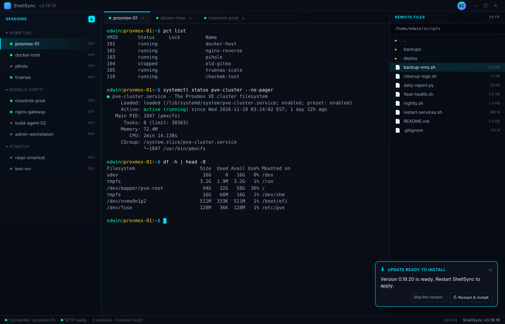

# ShellSync

A daily-driver SSH and RDP client for Windows, built around ergonomics and honest defaults.



## What it is

ShellSync is a personal SSH/RDP client I built because I wanted something that felt like SolarPuTTY (which I like) but that I actually maintain and can shape to my own workflow. It's designed for managing home lab and work Linux servers, plus Windows machines via RDP, in one window.

### Core

- **Multi-session tabbed terminal** with a floating three-column layout — session tree on the left, terminal(s) in the middle, file-transfer panel on the right
- **SFTP file browser** with dual-pane transfer confirmation, a sudo-elevated view for folders you can see but can't `ls`, and resumable transfers
- **RDP support** via native `mstsc.exe` — ShellSync hands credentials to Windows Credential Manager via `cmdkey.exe` and never stores RDP passwords itself
- **Real-time server stats** (Disk / CPU / RAM / uptime) for the active SSH session
- **Prompt-aware smart paste** — multi-line scripts with embedded `sudo` prompts don't get eaten; heredocs and comments survive the round-trip
- **Saved commands per session** with a reorderable list and one-click run

### Productivity

- **Broadcast input** — tag any set of tabs into a broadcast group, type once in any of them (or in the dedicated input in the broadcast banner), and the keystrokes fire on every member. A separate **🔒 Send password** button handles `sudo` prompts without the password ever touching a terminal visibly.
- **Command palette** (`Ctrl+Shift+P`) — fuzzy search over every saved session plus every action in the app (Settings, SSH Keys, Reset display, broadcast toggles, etc.). VS Code-style.
- **Collapsible sidebar + resizable file panel** — `Ctrl+\` collapses the sidebar to a 44px strip for small screens; drag the file panel's left edge to give the terminal more room. **Reset display** button in Settings puts everything back to defaults.

### Networking

- **Jump host / ProxyJump support** — pick another saved SSH session as the bastion in the New/Edit Session dialog. ShellSync connects to the jump first, then tunnels the target connection through it. Equivalent to `ssh -J`. Each hop verifies its own host key.
- **SSH Key Manager** — generate ed25519 keys inside ShellSync, import existing PEM/`.ppk` keys, copy the public key to the clipboard, and **deploy** to a server (ssh-copy-id equivalent — appends to `~/.ssh/authorized_keys` on the target). Per-session key picker in the session dialog.
- **SSH agent support** — Windows OpenSSH agent (built-in on Win10+) is tried first, then Pageant as fallback.

### Security

- **DPAPI-encrypted** SSH session passwords (same mechanism Chrome and Edge use on Windows)
- **Strict host-key TOFU** verification with SHA256 fingerprints — first-time acceptance is explicit, mismatches abort
- **App Login** — optional password gate at launch, with configurable auto-lock after N minutes of inactivity
- **Rate limiting** on App Login attempts to make brute-forcing impractical
- **SSH audit log** of every successful connection (viewable from Settings)
- **Lock on demand** from the user icon dropdown when you're stepping away

### Ops

- **Auto-update on startup** — ShellSync checks the GitHub Releases page a few seconds after launch and quietly downloads newer versions in the background. You're prompted before anything installs. Opt out in Settings → Updates if you'd rather stay pinned.
- **Settings → SSH audit log** opens the log viewer
- **Settings → SSH Keys manager** for key generation / import / deploy
- **Custom color themes** for the terminal with a save-your-own-preset feature

## Keyboard shortcuts

| Shortcut | Action |
|---|---|
| `Ctrl+Shift+P` | Command palette |
| `Ctrl+T` | New session |
| `Ctrl+W` | Close current tab |
| `Ctrl+D` | Duplicate current tab |
| `Ctrl+Tab` / `Ctrl+Shift+Tab` | Next / previous tab |
| `Ctrl+F` | Find in terminal |
| `Ctrl+B` | Toggle file panel |
| `Ctrl+\` | Collapse / expand sidebar |
| `Ctrl+Shift+B` | Add / remove current tab from broadcast group |
| `Ctrl` + `+` / `−` | Global terminal font size |
| `Ctrl` + scroll | Zoom active terminal only |

## What it isn't

- A commercial product with support SLAs
- A replacement for Royal TS, Devolutions RDM, or MobaXterm if you need enterprise features (team credential vaults, HSM integration, compliance certifications)
- Code-signed (yet). Windows will show a SmartScreen warning on first install — see the install section for how to handle that

## Install

**Requirements:** Windows 10 or 11, 64-bit.

1. Go to [Releases](https://github.com/LetsGetCracking/shellsync/releases)
2. Download the latest `ShellSync-Setup-X.Y.Z.exe`
3. (Optional but recommended) Verify the SHA256 hash — see `SHA256SUMS.txt` next to the installer
4. Run the installer
5. **Windows SmartScreen warning:** because the binary isn't code-signed, Windows will show "Windows protected your PC." Click **More info → Run anyway**. This is expected — it doesn't mean anything is wrong, just that Microsoft doesn't recognize the publisher yet
6. Follow the installer prompts

After the first install, ShellSync's **auto-updater** will handle subsequent versions — it'll download them in the background on launch and prompt you to restart when a new version is ready. You can disable this in Settings → Updates.

To verify the SHA256 hash yourself (recommended for anything security-relevant):

```powershell
Get-FileHash .\ShellSync-Setup-X.Y.Z.exe -Algorithm SHA256
```

Compare to the value in `SHA256SUMS.txt`.

## Building from source

Want to build ShellSync yourself instead of trusting the released binary? See [BUILDING.md](BUILDING.md) for full instructions. Short version:

```powershell
git clone https://github.com/LetsGetCracking/shellsync.git
cd shellsync
npm install
$env:CSC_IDENTITY_AUTO_DISCOVERY="false"
npm run build
```

The installer will be at `dist\ShellSync-Setup-X.Y.Z.exe`.

## Security posture

Short version: **credentials are encrypted with Windows DPAPI (same mechanism Chrome and Edge use), SSH host keys are verified with strict TOFU, and passwords are never persisted in plaintext.** RDP passwords go straight to Windows Credential Manager — ShellSync never stores them. SSH private keys generated or imported via the key manager live in `%APPDATA%\ShellSync\keys\` with the user-account-scoped file permissions Windows gives that folder — the private key bytes never leave the main process or cross IPC to the renderer.

Full details, including what's protected and what isn't, live in [SECURITY.md](SECURITY.md).

If you find a security bug, **please email me directly** rather than opening a public issue. Contact details in SECURITY.md.

## Support and expectations

This is a personal project. I use ShellSync daily, so bugs that affect me get fixed quickly. Bugs that don't affect me get fixed when I have time. If you file an issue expect a response within a couple weeks, and a fix on whatever cadence I can manage.

If you need enterprise-grade support, this isn't the tool for you — try [Royal TS](https://www.royalapps.com/), [Devolutions RDM](https://devolutions.net/remote-desktop-manager/), or [MobaXterm](https://mobaxterm.mobatek.net/).

## Contributing

Right now this is a personal project and I'm not accepting external code contributions — but bug reports and feature suggestions via GitHub issues are welcome. If you have a security issue, see [SECURITY.md](SECURITY.md) for the private disclosure process.

## License

MIT License — see [LICENSE](LICENSE) for details. In short: do what you want with it, don't blame me if it breaks.

## Acknowledgments

Built on top of:

- [Electron](https://www.electronjs.org/) — cross-platform desktop shell
- [xterm.js](https://xtermjs.org/) — terminal renderer
- [ssh2](https://github.com/mscdex/ssh2) — SSH protocol implementation in Node.js
- [electron-updater](https://www.electron.build/auto-update) — auto-update against GitHub Releases
- Microsoft's `mstsc.exe` and `cmdkey.exe` for RDP and Credential Manager integration

Inspired by SolarPuTTY's terminal ergonomics.

## Changelog

See [CHANGELOG.md](CHANGELOG.md) for the full version history.

---

*ShellSync is not affiliated with SolarWinds, Microsoft, or any of the projects it's built on.*
